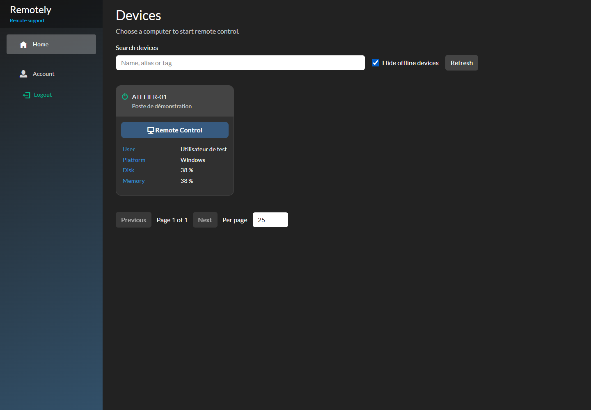

# RemotelyNew

Édition autonome de Remotely, centrée sur la prise en main sécurisée depuis un navigateur. Dépôt : https://github.com/lolosoftware/RemotelyNew — aucun lien de fork GitHub ni synchronisation automatique avec immense/Remotely.

- Console technicien entièrement web, MFA obligatoire.
- Home : appareils autorisés et bouton **Remote Control** sur chaque carte.
- Membre : **Home, Account, Logout**. Administration séparée.
- **Scripts, Quick Scripts et Terminal supprimés**, y compris leurs API, messages d'exécution, ordonnanceur et moteur PowerShell de l'agent.
- Installateur Windows natif, paquets vérifiés par signature, reprise des identifiants et de la configuration existante.
- Votre propre image Docker, avec serveur, agents et paquets d'installation compilés ensemble.

## Sur ce PC

La distribution WSL **Remotely-Dev** contient Docker Engine et Compose. La recette locale utilise un volume propre et écoute uniquement sur la boucle locale.

~~~powershell
./Utilities/Start-Local.ps1
~~~

Ouvrir http://localhost:5080, créer son compte et inscrire son authentificateur. Pour arrêter en conservant les données :

~~~powershell
./Utilities/Stop-Local.ps1
~~~

Le mode local HTTP est réservé à la recette sur ce PC. Pour des agents réels et la production, utiliser un nom DNS et HTTPS avec la configuration Caddy fournie. Les installateurs d'agents exigent HTTPS.

## Reprendre le projet

Lire [le guide de maintenance, de migration et de déploiement](docs/EXPLOITATION.md), puis [le périmètre et les limites de validation](docs/MODERNISATION.md).

~~~powershell
pnpm --dir Server install --frozen-lockfile --ignore-scripts
pnpm --dir Server run build
pnpm --dir Server test
dotnet restore Remotely.Build.slnx --locked-mode
dotnet test Remotely.Build.slnx -c Release --no-restore
~~~

.NET 10, Node 24 et pnpm 10.32.1 requis. Les modèles de CI sont dans docs/ci-templates ; leur activation dans .github/workflows attend la permission GitHub Workflows du jeton de publication. L'installateur se construit séparément avec votre clé publique épinglée ; Build-Release.ps1 automatise l'ensemble.

## Origine et licence

Dérivé du projet Remotely d'Immense Networks/Jared Goodwin, base ec0d45d8 du 17 décembre 2024. Historique amont conservé dans une branche locale d'archive ; publication avec un nouvel historique propre. Mentions d'origine conservées. Le dépôt est géré indépendamment, avec sa propre chaîne de publication. La [licence GPLv3](LICENSE) et les licences tierces restent applicables. Les anciens documents sont archivés sous docs/archive et ne sont pas les instructions de déploiement de cette édition.
